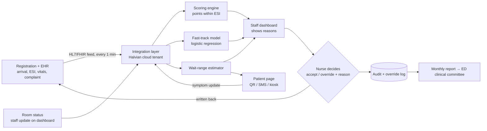

# 1. AI Tool Architecture

**Owner:** Priya · **Rubric:** 9 pts (Focus 2 · Oversight 2 · Tools 2 · Technical design 3)
Status: 🟢 complete draft. Numbers match [CONTEXT_BUNDLE.md](CONTEXT_BUNDLE.md) and [docs/BUDGET_ROI.md](docs/BUDGET_ROI.md).

---

## 1.1 Focus area & rationale (2 pts)
**Intake & Triage**, from the moment a patient checks in until a provider sees them.

| Why here | Halvian | National | Gap |
|---|---|---|---|
| Median door-to-provider | 55 min | 30–40 min | +15–25 min |
| Left without being seen (LWBS) | 4.0% (≈3,400 patients/yr) | 2–3% | ≈850–1,700 extra patients/yr leave unseen |
| Uninsured vs commercial wait | 64 vs 48 min | — | 16-min equity gap |
| Uninsured vs commercial LWBS | 5.8% vs 3.0% | — | Nearly double |

**Who is affected:**
- **Low-urgency patients (ESI 4–5)** wait 2+ hours on surge days, even though 8 fast-track rooms exist. These patients are disproportionately Medicaid and uninsured; uninsured visits are 3.8 points more likely to be nonurgent (AJMC).
- **Triage nurses** sort the waiting room by hand, re-check patients from memory, and field "how much longer?" questions.
- **Patients** get few updates. Not knowing how long the wait will be is a main driver of LWBS.

**Why not the other focus areas:**
- **Patient flow / boarding:** enterprise platforms are quote-only. Tampa General's GE command center cost about $13M, 17× our 18-month budget.
- **Staffing forecasts:** don't change how the queue is ordered.
- **Patient communication:** built into our tool through the wristband QR link, SMS and a kiosk.

## 1.2 What AI does vs what stays human (2 pts)
| Step | AI does | Human decides | Accountable owner |
|---|---|---|---|
| Queue ordering | Scores patients **within the same ESI level** and shows every point's reason | Confirms the order, can move or pin a patient with a logged reason | **Charge nurse** |
| Fast-track | Gives an eligibility score (e.g. "89% likely quick case") from intake data | Accepts, declines or overrides with a reason code | **Triage nurse**; the **APP** owns care once the patient is in fast-track |
| Symptom updates | **An LLM (Gemini; Claude also supported)** reads a patient's own-words description and returns a category, a red-flag check and a one-line summary for the nurse. A keyword safety net runs alongside it, and either one can page a nurse. Red flags bypass scoring | Re-assesses the patient and confirms before any points count | **Triage nurse** |
| Wait-time range | Estimates a range from the queue and open rooms (never shown to ESI 1–2) | Staff update room status; can correct estimates | **Charge nurse** |
| Patient thinking of leaving | Alerts a nurse; **the LLM** drafts a "leave with a plan" message in the patient's language | Edits and approves the message before the patient sees it, or talks to the patient in person | **Triage nurse** |
| Weights & cutoffs | Monthly report comparing suggestions with outcomes | Approves any change; **the model never changes itself** | **ED clinical committee** |

**When the AI is wrong:**
- **Clinical decisions:** the clinician who accepted a suggestion owns that decision, as with any decision-support tool. ESI assignment always stays with the nurse.
- **Configuration and performance:** the **ED medical director and ED nurse manager** own the weights, cutoff and pause decisions.
- **Uptime and security:** **clinical informatics / IT** owns these.

## 1.3 Tools (2 pts)
| Need | Tool | Rough cost | Why it fits a small ED team |
|---|---|---|---|
| Hosting + language model | **Google Cloud Vertex AI (Gemini)**, or Azure OpenAI / AWS Bedrock, inside Halvian's own cloud tenant, under a BAA | ≈$3K/month | Pay-per-use and HIPAA-eligible. Used only for low-risk text tasks: mapping free-text symptoms to categories and drafting messages. |
| Fast-track prediction | **Logistic regression** trained on Halvian's past triage visits (scikit-learn); weights exported to the app | ≈$0 licence; validation time in the monitoring budget | Simple, explainable (each factor's weight is visible), cheap to run, easy to audit for bias |
| Queue scoring | **Rules-based points matrix** with nurse-set weights | Built into the app | Transparent; nurses can see and change every weight |
| EHR integration | **FHIR APIs / HL7 ADT feeds** from the existing EHR and registration system, through the hospital's interface engine | ≈$140K over 18 months | Reuses systems Halvian already has. Results go back into the EHR so nurses need no extra login. |
| Patient messaging | **Twilio** SMS (BAA) + wristband QR web page + **4 kiosks** | ≈$30K over 18 months | No app or account needed, which is an equity choice for Medicaid and uninsured patients. Multiple languages. |
| Staff dashboard | Web app embedded in the EHR (our demo), or the hospital's existing **Power BI / low-code platform** | ≈$120K build over 18 months | Runs on the existing EHR screen |

**Lower-cost alternatives we considered:**
- The EHR vendor's built-in AI modules. These are cheapest if licensed, but less transparent.
- A self-hosted open-source model, which removes per-call fees but adds IT burden.
- Rules only, with no ML for fast-track. This is the safest fallback, but it loses accuracy.

## 1.4 Technical design (3 pts)

- **Data used:** arrival time, age, arrival mode, chief complaint, vitals, ESI, re-check times, nurse-confirmed symptom updates, room status. **Insurance is excluded from every model** and used only in the fairness panel to compare waits, scores, overrides and LWBS by group.
- **How information flows:**
  1. Registration and triage data arrive from the EHR feed in near real time.
  2. The queue is recalculated every minute.
  3. Suggestions appear with their reasons on the dashboard.
  4. Nothing changes a patient's position or stream until a nurse confirms.
  5. Every decision is written back to the EHR and logged.
- **Where it runs:** in Halvian's own cloud tenant under a BAA, so patient data never leaves Halvian's environment. The fast-track model is a short list of weights and runs anywhere, even in the browser.
- **Cost:** ≈$700K over 18 months, then ≈$140K/yr to run (see [Budget & ROI](docs/BUDGET_ROI.md)).
- **Scalability:**
  - The scoring is lightweight: about 40–100 patients waiting, recalculated once a minute.
  - It handles Monday peaks and the +20% winter surge with no added infrastructure.
  - The same pattern can extend later to urgent care or other departments.
- **Reliability:**
  - If the tool or the feed fails, the dashboard shows an **"AI offline"** banner, and the queue falls back to ESI level, then arrival time.
  - Triage then continues exactly as it does today, so staff need no new downtime procedure. The demo has this toggle.
- **Maintenance:**
  - Clinical informatics owns the tool, at about 0.3 FTE.
  - The model is reviewed monthly.
  - A bias audit runs quarterly.
  - Retraining happens at month 13–15, and only after committee approval.
- **Privacy & clinical risk:**
  - Collect only the identifiers needed.
  - Encrypt data in transit and at rest.
  - Use role-based access with audit logs.
  - The patient link is a wristband token that expires at discharge and shows no diagnosis.
  - See [Risk §4.2](docs/RISK_SECURITY.md).

## Demo-to-production mapping
| Demo (synthetic) | Production |
|---|---|
| `data/patients.js`, 40 synthetic patients | Live EHR/registration feed |
| `data/history.js`, 3,000 synthetic past visits | Halvian's historical triage data (de-identified for training) |
| Fast-track model trained offline (`scripts/train_fasttrack.py`): bounce-back 3.3% at the 86% cutoff (target < 5%). AUC is 0.98 overall and 0.97 for ESI 3–5, but on **synthetic** labels, which are cleaner than real triage data. The published real-world benchmark is 0.87 (Kaiser) | The same pipeline retrained on Halvian's data. Go-live bar in silent mode: AUC ≥ 0.85 and bounce-back < 5% |
| Gemini (default) or Claude called from the browser (`src/shared/ai.js`) with a presenter's API key held in page memory only (or `window.claude` when run as a Claude artifact). A labelled keyword fallback runs if AI isn't connected | Gemini through Halvian's private Google Cloud Vertex AI project (or another model via Azure OpenAI / AWS Bedrock) under a BAA. Identifiers are stripped before sending, and no data is retained for training |
| Room board clicked by hand | Same, replacing the phone and whiteboard; later, an EHR bed feed |
