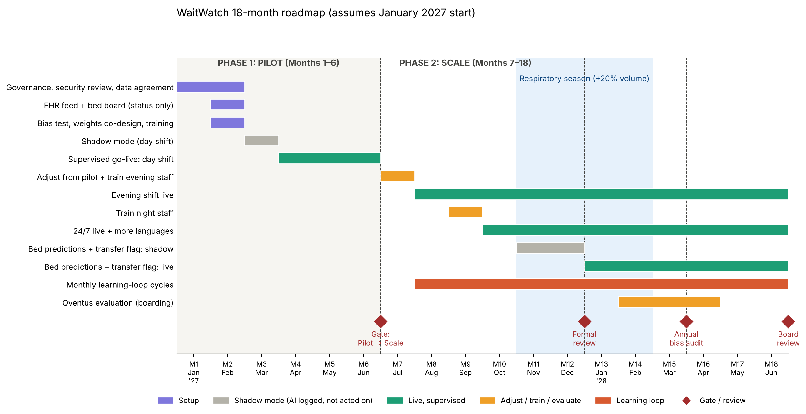

# Roadmap & Milestones

Assumes a January 2027 start. Baselines are from the Halvian brief. Month 6 targets apply to pilot shifts; Month 18 targets apply to the whole ED. Starting weights and thresholds are illustrative; Halvian's nurse committee confirms them in Month 2.

## Measurable goals (four)

| Goal | Baseline | Month 6 (pilot shifts) | Month 18 (whole ED) | Why this target | If missed |
| --- | --- | --- | --- | --- | --- |
| 1. Speed: median door-to-provider time | 55 min | 50 min | 42 min | Top of the national 30–40 min range: ambitious, but credible in 18 months | Find the bottleneck (rooms vs triage); adjust fast-track cutoff and weights; add provider-in-triage hours on surge days |
| 2. Access: walk-outs (LWBS) | 4.0% | 3.5% | 3.0% | Inside the national 2–3% range | Check wait-range accuracy and before-you-go response times; expand nurse rounding |
| 3. Equity: close gaps for uninsured and Medicaid patients | Overall wait gap vs commercial: uninsured 16 min, Medicaid 10 min Walk-outs: uninsured 5.8%, Medicaid 4.6% Same-acuity gap measured from 12 months of data in Month 2 | Same-acuity gaps not widened, trending down Uninsured walk-outs ≤5.0% | Same-acuity gaps halved Walk-outs: uninsured ≤4.0%, Medicaid ≤3.3% | Measured within the same acuity level, so sicker patients being seen first is not counted as unfair | If any gap widens 2 weeks in a row: pause re-ranking, audit, expand nurse rounding for that group |
| 4. Safety: no harm from speed | 72-hour return rate (measured Month 2) | Zero serious AI-linked incidents 72-hour returns not above baseline | Same as Month 6 | Speed must not come from rushed care | Any serious incident: pause the feature involved and run a root-cause review |

## Tracking progress and acting on misses

| Cadence | What happens |
| --- | --- |
| Weekly | Automated dashboard from tool logs and EHR timestamps, split by shift, acuity level, insurance group and language |
| Monthly | Nurse committee reviews trends and approves any weight or threshold change |
| Quarterly | Report to the executive board against the four goals |

| Status | Trigger | Action |
| --- | --- | --- |
| Green | On or ahead of the path to target | No change |
| Amber | Off-path for 2 weeks in a row, but not worse than baseline | Nurse committee identifies the cause within 1 week and applies a fix (weights, cutoff, staffing, rounding) |
| Red | Worse than baseline, any equity gap widening 2 weeks in a row, or any serious AI-linked incident | Pause the responsible feature; revert to the previous version or the manual process; restart only after committee sign-off |

# Phase 1: Pilot (Months 1–6)

Scope: weekday day shifts (7am–3pm). Features piloted: queue ranking within each acuity level, fast-track suggestion, "Update my symptoms" (app, kiosk or nurse rounding) and the before-you-go button. The bed board runs as status only, with no predictions.

| Month | Milestone |
| --- | --- |
| 1 | Governance: ED medical director accountable for the tool; nurse committee and AI oversight committee formed. Vendor security review and data agreement (BAA) begin. Data-access approval. Pull 12 months of historical data |
| 2 | Security review and BAA signed. Read-only EHR feed live and tested. Digital bed board live (replaces whiteboard). Bias test on historical data; same-acuity and 72-hour-return baselines set. Nurses co-design starting weights. Training: 2 hrs per nurse, 1 hr per physician and registration staff. Downtime drill |
| 3 | Shadow mode: AI suggestions logged and compared with nurse decisions; nobody acts on them. Go-live readiness check at month end (below) |
| 4–5 | Supervised go-live on day shifts. Daily huddle in week 1, then weekly reviews. Patient app and kiosk in English and Spanish |
| 6 | Gate review by the AI oversight committee |

## Go-live readiness check (end of Month 3)

| Check | Pass mark |
| --- | --- |
| Fast-track suggestions | Nurses accept ≥70% in shadow comparison; fewer than 5% would have needed sending back |
| Fairness | At the same acuity, fast-track suggestion rates differ by less than 5 points between insurance groups |
| Ranking rule | No patient ever ranked above a higher-acuity patient |
| Staff readiness | ≥90% of pilot-shift nurses trained |

## Gate criteria to move to Phase 2 (Month 6)

Measured over Months 4–6 against the same shifts in the same months last year, adjusted for patient volume. All must pass. If any fails, the pilot is extended 2–3 months and re-reviewed; a safety failure pauses the feature involved.

| Criterion | Pass mark |
| --- | --- |
| Safety | Zero serious AI-linked events; 72-hour returns not above baseline |
| Speed | Door-to-provider time ≥5 min faster |
| Walk-outs | ≥0.3 points lower |
| Equity | Same-acuity gaps for uninsured and Medicaid not widened and trending down over Months 4–6 |
| Adoption | Used on ≥70% of pilot shifts; override rate between 5% and 30% |
| Fast-track accuracy | Fewer than 5% of fast-track patients sent back to the main ED |
| Patient reach | ≥40% of waiting patients reached via app, kiosk or nurse rounding; no group below 70% of its share of patients |
| Reliability | ≥99% uptime; downtime drill passed |

## Success metrics (pilot)

| Category | Metric | Pilot target |
| --- | --- | --- |
| Operations | Door-to-provider time; walk-outs; fast-track send-back rate | −5 min; −0.3 pts; <5% |
| Adoption | Shift usage; override rate | ≥70%; 5–30% |
| Patient experience | Reach; flagged confusing answers; satisfaction score | ≥40%; reviewed weekly; above pre-pilot score |
| Equity | Same-acuity gaps; walk-outs by group; reach by insurance and language group | Not widened; uninsured ≤5.0%; no group <70% of share |

## Adoption plan

| Audience | Actions |
| --- | --- |
| Skeptical clinicians | • Nurses co-design and own the weights through the nurse committee • Shadow mode proves value before anyone relies on the tool • Every ranking shows its reason; nurses can always override (reason required) • A nurse champion on every pilot shift; a physician champion for fast-track • Data is never used in individual performance reviews • Weekly feedback huddle; fixes shown back to staff within 2 weeks |
| Patients | • Plain-language signs: "AI helps nurses; nurses decide" • QR code tied only to the visit number: no name, birthday or address • Privacy notice in the top languages: used only for care here, shared only where the law requires • Optional, never an advantage: nurse rounding logs the same updates for patients who skip the app • Kiosk with staff help, picture-based options and no login • Feedback button and flag for confusing answers |

# Phase 2: Scale (Months 7–18)

## How pilot results decide what changes

| If the pilot shows… | Then… |
| --- | --- |
| More than 5% of fast-track patients sent back | Raise the fast-track cutoff before expanding |
| Overrides above 30% on one scoring criterion | Nurse committee reviews and re-weights that criterion |
| An equity gap at amber | Expand nurse rounding for that group before adding shifts |
| Wait ranges off by more than 15 min | Recalibrate the wait-range model, checked by group |
| Low app reach in a language group | Add translations and community review of the notices |
| All gates passed with margin | Proceed to evening, then night shifts on schedule |

## Milestones

| Month | Milestone |
| --- | --- |
| 7 | Apply pilot adjustments. Train evening staff |
| 8 | Evening shift live (supervised). Monthly learning-loop cycles begin |
| 9 | Train night staff |
| 10 | 24/7 live. Two more languages added |
| 11–12 | Bed predictions and transfer flag in shadow mode. Winter surge plan active (respiratory season Nov–Feb, about +20% volume): capacity alerts and extra fast-track hours |
| 12 | Formal review by the oversight committee and the board |
| 13 | Bed predictions and transfer flag go live, if shadow accuracy passes |
| 14–16 | Evaluate Qventus for inpatient discharge and boarding |
| 15 | Annual bias audit |
| 18 | Board review against the four goals; decide steady-state operation |

## Metrics during scale-up

| Metric | Why it matters | Month 18 target |
| --- | --- | --- |
| Door-to-provider time, by shift | Efficiency | 42 min (Goal 1) |
| Walk-outs, by group | Access and equity | 3.0% overall; uninsured ≤4.0%; Medicaid ≤3.3% |
| Same-acuity gaps | Equity, not only averages | Halved (Goal 3) |
| 72-hour returns | Safety | Not above baseline (Goal 4) |
| Override rate, by shift | Trust and calibration | 5–30% |
| Cost to serve | Value | Annual tool cost ÷ 85,000 visits (e.g. $500k ≈ $5.90 per visit; use the budget slide's figure) |

## Long-term operations

| Area | Plan |
| --- | --- |
| Ownership | • ED nursing director: daily operations • Clinical informatics: maintenance, monitoring, vendor management • AI oversight committee (ED medical director, nurse representatives, IT security, patient/equity representative): safety and fairness |
| Maintenance | Vendor service agreement with uptime and security-patch commitments; monthly model monitoring; quarterly security review |
| Funding | Months 1–18 from the $500k/yr innovation budget. From Month 19, an ED operating budget line, justified by the ROI on the budget slide (avoided overtime and staffing, recovered visits) |
| Training | New-hire onboarding module; annual refresher for all ED staff |
| Updates | Quarterly review; weight changes only through the nurse committee, logged and reversible |
| Retire or replace if | Bias persists for 2 quarters, a safety gate fails and can't be fixed, or a better EHR-native tool becomes available |
